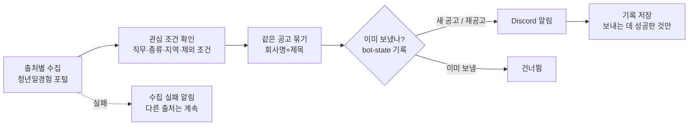

# 취업 공고 알림 봇

청년일경험 포털 등에 올라오는 **IT 인턴·일경험·신입 공고**를 하루 두 번 확인해서, 조건에 맞는 새 공고만 **Discord**로 알려 주는 개인용 봇입니다.

- 실행: GitHub Actions (매일 09:00, 18:00 KST), 서버 없이 무료
- 언어: Python 3.12, 표준 라이브러리만 사용 (테스트용 pytest 제외)

## 왜 만들었나

청년일경험 공고는 모집 기간이 **일주일 안팎으로 짧고**, 여러 사이트에 흩어져 있습니다. 직접 들어가서 확인하다 보면 놓치는 공고가 생겼습니다. 그래서 다음을 자동으로 하도록 만들었습니다.

1. 새 공고가 올라오면 바로 알기
2. 관심 없는 공고(먼 지역, 경력직, 학력 제한)는 거르기
3. 같은 공고가 두 번 오지 않게 하기

## 동작 흐름



## 설계하면서 정한 것

용어는 [CONTEXT.md](CONTEXT.md)에, 되돌리기 어려운 결정은 [docs/adr](docs/adr)에 이유와 함께 적어 두었습니다.

| 상황 | 정한 동작 | 이유 |
|---|---|---|
| 같은 공고가 여러 사이트에 올라옴 | 회사명+제목이 같으면 **한 번만**, 출처별 링크를 함께 | 알림이 중복되면 결국 안 보게 됨 |
| 알림 보낸 공고가 수정됨 (마감 연장 등) | 다시 보내지 않음 | 공고 하나당 알림 한 번 |
| 마감된 공고가 다시 올라옴 | **재공고**로 보고 다시 알림 | 다시 지원할 기회이므로 |
| 학력 정보가 없음, 상시채용 | 거르지 않고 보냄 ("학력 확인 필요" 표시) | 확인 못 한 걸 빼면 좋은 공고를 놓침 |
| 지역이 "지역무관" | 지역 목록에 넣지 않으면 **받지 않음** | 실제로 써 보니 지역무관은 대부분 비대면 프로젝트형이라, 포털에서 직접 보던 범위(인턴형·서울/경기/인천)와 달랐음 |
| 한 출처가 고장 | 그 출처만 **수집 실패 알림**, 나머지는 계속 | 조용히 실패하면 "오늘은 공고가 없나" 하고 착각함 |
| Discord 전송 실패 | 기록하지 않음 → **다음 실행 때 다시 보냄** | 실패한 공고를 놓치지 않게 |
| 저장소가 공개 | 보낸 기록에 제목·회사명 대신 **해시값**만 저장 | 희망 직무·지역이 드러나지 않게 |
| 잡코리아·원티드 | **자동 수집하지 않음** | 약관에서 자동 수집·무단 복제를 금지 ([ADR 0001](docs/adr/0001-잡코리아-원티드-자동수집-제외.md)) |
| 실행 환경 | GitHub Actions + 기록은 `bot-state` 브랜치 | 코드 기록과 봇 기록 분리 ([ADR 0002](docs/adr/0002-github-actions-실행과-bot-state-브랜치.md)) |

## 테스트

`python -m pytest -v` 로 실행합니다. 테스트는 아래 **세 경계**에서만 합니다. 내부 구현을 바꿔도 동작이 같으면 테스트가 깨지지 않게 하려는 것입니다.

| 경계 | 파일 | 확인하는 것 |
|---|---|---|
| ① 한 번의 실행 | [tests/test_run.py](tests/test_run.py) | 관심 조건 필터, 같은 공고 묶기, 재실행 시 중복 없음, 재공고, 출처 실패 격리, 전송 실패 재시도, 기록에 제목이 남지 않음 |
| ② 출처별 변환 | [tests/test_youth_work.py](tests/test_youth_work.py) | **실제로 받은 목록 페이지**(2026-11-09)로 회사명·마감일·지역·링크 읽기, 페이지 넘김, 사이트 구조가 바뀌었을 때 실패로 알리기 |
| ③ Discord 전송 | [tests/test_discord.py](tests/test_discord.py) | 알림 내용(D-day, 마감 3일 이내 빨간색, 출처별 링크), `@everyone` 차단, 429(전송 제한) 재시도, 웹훅 주소가 오류 메시지에 노출되지 않음 |

외부(사이트, Discord)와 현재 시각만 가짜로 바꿔 끼우고, 기록 파일은 진짜 임시 파일을 씁니다. 테스트를 먼저 쓰고 통과하는 코드를 쓰는 순서(TDD)로 만들었습니다.

## 직접 실행해 보기

```bash
python -m jobalert --dry-run     # Discord 로 보내지 않고 보낼 공고만 화면에 출력
python -m jobalert               # 실제 실행 (.env 에 DISCORD_WEBHOOK_URL 필요)
```

1. `.env` 파일을 만들고 `DISCORD_WEBHOOK_URL=웹훅주소` 한 줄을 넣습니다. (`.env` 는 GitHub 에 올라가지 않음)
2. 관심 조건은 [config.json](config.json) 에서 바꿉니다.
   - `job_keywords`: 제목이나 직무 분류에 들어 있으면 통과
   - `kinds`: 공고 종류
   - `regions`: 지역. "지역무관" 공고도 받으려면 목록에 `"지역무관"` 을 넣음
   - `exclude_keywords`: 제목에 있으면 제외
   - `program_types`: 받을 일경험 유형 (인턴형 / 프로젝트형 / ESG지원형 / 기업탐방형)

## GitHub Actions 설정

1. 저장소 › Settings › Secrets and variables › Actions › **New repository secret**: `DISCORD_WEBHOOK_URL`
2. 저장소 › Settings › Actions › General › Workflow permissions: **Read and write permissions** (기록을 `bot-state` 브랜치에 저장하기 위해)
3. Actions 탭 › 「공고 알림」 › **Run workflow** 로 바로 실행해 볼 수 있습니다 (`dry_run` 체크 시 출력만).

## 운영 가이드

| 증상 | 원인 | 조치 |
|---|---|---|
| Discord 에 "⚠️ 수집 실패 알림" | 사이트 점검·접속 차단·구조 변경 | 다음 실행 때 자동으로 다시 시도. 계속되면 Actions 로그 확인. "목록을 찾지 못함"이면 사이트 구조가 바뀐 것 → `jobalert/sources/` 수정 |
| GitHub 에서 실패 메일이 옴 | 위와 같음, 또는 Discord 전송 실패 | 실패한 공고는 기록하지 않았으므로 다음 실행 때 다시 보냄 |
| 알림이 하나도 안 옴 (실패 메일도 없음) | 예약 실행이 멈춤 | 공개 저장소는 60일간 활동이 없으면 예약 실행이 멈출 수 있음. Actions 탭에서 다시 켜기 |
| 같은 공고가 두 번 옴 | 회사명이나 제목 표기가 출처마다 다름 | 의도된 한계. 띄어쓰기·전각 괄호 차이만 같게 봄 |
| 웹훅 주소가 유출됨 | — | Discord 에서 웹훅 삭제 후 새로 만들고 Secret 교체 |

## 한계와 다음 단계

- **출처**: 지금은 청년일경험 포털 하나입니다. 공식 API가 있는 **잡알리오**(공공기관 채용·체험형 인턴)와 **사람인**을 붙일 예정입니다. 출처는 `fetch()` 하나만 가진 파일로 분리해 두어서 추가할 때 기존 코드를 고치지 않습니다.
- **학력 제한**: 청년일경험 목록에는 학력 조건이 없어 "확인 필요"로 표시합니다.
- **마감 임박 알림**: 다음 날 마감되는 공고를 아침에 모아서 알려 주는 기능은 아직 없습니다.
- **청년일경험 포털**은 공식 API가 없어서, 누구나 로그인 없이 보는 목록 페이지를 하루 두 번 읽습니다. robots.txt 가 막지 않는 경로이며, 사이트 구조가 바뀌면 수집 실패 알림으로 알 수 있게 했습니다.

## 만든 방법

코드는 **Claude Code**(AI 코딩 도구)로 작성했습니다. 직접 한 일은 아래와 같습니다.

- 무엇을 만들지와 설계 결정: 쓰는 사람, 출처 선정과 약관 검토, 중복·재공고 기준, 실패 처리 방식
- 테스트할 경계를 정하고 결과 검증
- 실제 사이트로 돌려 보며 확인

## 폴더 구조

```
jobalert/
  run.py            한 번의 실행 (수집 → 조건 → 묶기 → 알림 → 기록)
  model.py          공고(Posting), 관심 조건
  store.py          보낸 공고 기록 (해시로 저장)
  discord.py        Discord 알림
  http.py           바깥과 HTTP 통신 (테스트에서 가짜로 교체)
  sources/
    youth_work.py   청년일경험 포털
tests/              세 경계의 테스트 + 실제 응답 샘플
docs/adr/           설계 결정 기록
CONTEXT.md          용어집
config.json         관심 조건
```
