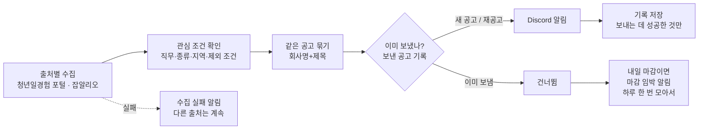

# 취업 공고 알림 봇

청년일경험 포털의 **IT 인턴형 일경험 공고**와 잡알리오의 **공공기관 체험형 청년인턴 공고**(서울·경기·인천)를 하루 두 번 확인해서, 조건에 맞는 새 공고만 **Discord**로 알려 주는 개인용 봇입니다.

- 실행: 윈도우 작업 스케줄러 (매일 09:00, 18:00). 처음엔 GitHub Actions로 돌렸지만 포털이 해외 IP를 막아 옮김 ([아래](#실행-위치를-옮긴-이유))
- 테스트: 코드를 올릴 때마다 GitHub Actions에서 자동 실행
- 언어: Python 3.12, 표준 라이브러리만 사용 (테스트용 pytest 제외)

## 왜 만들었나

청년일경험 공고는 모집 기간이 **일주일 안팎으로 짧고**, 여러 사이트에 흩어져 있습니다. 직접 들어가서 확인하다 보면 놓치는 공고가 생겼습니다. 그래서 다음을 자동으로 하도록 만들었습니다.

1. 새 공고가 올라오면 바로 알기
2. 관심 없는 공고(먼 지역, 경력직, 학력 제한)는 거르기
3. 같은 공고가 두 번 오지 않게 하기

## 동작 흐름



## 설계하면서 정한 것

용어는 [CONTEXT.md](CONTEXT.md)에, 되돌리기 어려운 결정은 [docs/adr](docs/adr)에 이유와 함께 적어 두었습니다.

| 상황 | 정한 동작 | 이유 |
|---|---|---|
| 같은 공고가 여러 사이트에 올라옴 | 회사명+제목이 같으면 **한 번만**, 출처별 링크를 함께 | 알림이 중복되면 결국 안 보게 됨 |
| 알림 보낸 공고가 수정됨 (마감 연장 등) | 다시 보내지 않음 | 공고 하나당 알림 한 번 |
| 알림 보낸 공고가 내일 마감 | 그날 첫 실행 때 **마감 임박 알림** 한 메시지로 모아 보냄 | 봤지만 지원을 미루다 놓치는 일을 막으려고. 공고마다 따로 보내면 시끄러움 |
| 마감된 공고가 다시 올라옴 | **재공고**로 보고 다시 알림 | 다시 지원할 기회이므로 |
| 학력 정보가 없음, 상시채용 | 거르지 않고 보냄 ("학력 확인 필요" 표시) | 확인 못 한 걸 빼면 좋은 공고를 놓침 |
| 장애인·대학 재학생 **전용** 전형 공고 | 받지 않음. 일반 전형이 함께 있는 공고는 받음 | 실제 공고의 신청자격을 확인해 보니 전용 전형은 제목에 드러남("장애전형", "대학생인턴"). 기관 이름(한국장애인고용공단)만 걸리지 않게 구체적인 표현으로 거름 |
| 대체근로자·대체인력 공고 | 받지 않음 (제목에 "대체근로", "대체 근로", "대체인력") | 휴직자 자리를 잠깐 채우는 자리라 찾는 공고와 다름 |
| 지역이 "지역무관" | 지역 목록에 넣지 않으면 **받지 않음** | 실제로 써 보니 지역무관은 대부분 비대면 프로젝트형이라, 포털에서 직접 보던 범위(인턴형·서울/경기/인천)와 달랐음 |
| 한 출처가 고장 | 그 출처만 **수집 실패 알림**, 나머지는 계속 | 조용히 실패하면 "오늘은 공고가 없나" 하고 착각함 |
| Discord 전송 실패 | 기록하지 않음 → **다음 실행 때 다시 보냄** | 실패한 공고를 놓치지 않게 |
| 보낸 공고 기록 | 제목·회사명 대신 **해시값**만 저장 | 기록 파일이 어디에 남더라도 희망 직무·지역이 드러나지 않게 |
| 잡코리아·원티드 | **자동 수집하지 않음** | 약관에서 자동 수집·무단 복제를 금지 ([ADR 0001](docs/adr/0001-잡코리아-원티드-자동수집-제외.md)) |
| 실행 환경 | 내 PC 작업 스케줄러, 놓친 실행은 PC를 켜면 바로 실행 | 포털이 해외 IP 접속을 받지 않음 ([ADR 0003](docs/adr/0003-내-PC-작업-스케줄러로-실행.md)) |

## 테스트

`python -m pytest -v` 로 실행합니다. 테스트는 아래 **세 경계**에서만 합니다. 내부 구현을 바꿔도 동작이 같으면 테스트가 깨지지 않게 하려는 것입니다.

| 경계 | 파일 | 확인하는 것 |
|---|---|---|
| ① 한 번의 실행 | [tests/test_run.py](tests/test_run.py) | 관심 조건 필터, 같은 공고 묶기, 재실행 시 중복 없음, 재공고, 출처 실패 격리, 전송 실패 재시도, 기록에 제목이 남지 않음, 마감 임박 알림(하루 한 번·새 공고 제외·실패 시 재시도) |
| ② 출처별 변환 | [tests/test_youth_work.py](tests/test_youth_work.py), [tests/test_jobalio.py](tests/test_jobalio.py) | **실제로 받은 응답**(2026-11-09)으로 회사명·마감일·지역·링크 읽기, 페이지 넘김, 학력 조건 판단, 사이트 구조 변경·인증키 오류를 수집 실패로 알리기, 오류 메시지에 인증키가 노출되지 않음 |
| ③ Discord 전송 | [tests/test_discord.py](tests/test_discord.py) | 알림 내용(D-day, 마감 3일 이내 빨간색, 출처별 링크), `@everyone` 차단, 429(전송 제한) 재시도, 웹훅 주소가 오류 메시지에 노출되지 않음 |

외부(사이트, Discord)와 현재 시각만 가짜로 바꿔 끼우고, 기록 파일은 진짜 임시 파일을 씁니다. 테스트를 먼저 쓰고 통과하는 코드를 쓰는 순서(TDD)로 만들었습니다.

## 직접 실행해 보기

```bash
python -m jobalert --dry-run     # Discord 로 보내지 않고 보낼 공고만 화면에 출력
python -m jobalert               # 실제 실행 (.env 에 DISCORD_WEBHOOK_URL 필요)
```

1. `.env` 파일을 만들고 `DISCORD_WEBHOOK_URL=웹훅주소`, `JOBALIO_SERVICE_KEY=공공데이터포털_인증키` 를 넣습니다. (`.env` 는 GitHub 에 올라가지 않음, 키가 없으면 잡알리오는 건너뜀)
2. 관심 조건은 [config.json](config.json) 에서 바꿉니다.
   - `job_keywords`: 제목이나 직무 분류에 들어 있으면 통과 (비워 두면 직무로 거르지 않음. 지금은 출처에 요청할 때 범위를 좁힘: 청년일경험 = IT 직무, 잡알리오 = 체험형 청년인턴)
   - `kinds`: 공고 종류
   - `regions`: 지역. "지역무관" 공고도 받으려면 목록에 `"지역무관"` 을 넣음
   - `exclude_keywords`: 제목에 있으면 제외
   - `program_types`: 받을 일경험 유형 (인턴형 / 프로젝트형 / ESG지원형 / 기업탐방형)

## 매일 자동 실행 (윈도우 작업 스케줄러)

```powershell
.\scripts\register_task.ps1      # "취업공고알림" 작업 등록: 매일 09:00, 18:00
```

- 창 없이(`pythonw`) 실행되고, 결과는 `state/run.log` 에 한 줄씩 남습니다.
- PC가 꺼져 있어 놓친 실행은 PC를 켜면 바로 한 번 실행됩니다.

## 실행 위치를 옮긴 이유

처음에는 서버 없이 무료로 돌릴 수 있는 **GitHub Actions**에서 하루 두 번 실행했습니다. 그런데 첫 실행부터 실패했습니다.

1. 첫 실행: Discord 로 "⚠️ 청년일경험 수집 실패: 연결 실패 (URLError)" 알림이 왔지만, 원인이 클래스 이름뿐이라 알 수 없었습니다.
2. 오류의 **자세한 원인을 함께 남기고**, Actions 실행 화면(Annotations·Summary)에 **로그인 없이도 보이게** 고쳤습니다.
3. 다시 실행하니 `URLError: timed out` 이 나왔습니다. SSL 오류가 아니라 **응답이 아예 없는 것**이었고, 같은 코드가 국내 PC 에서는 1초 안에 동작했습니다. 그래서 **포털이 해외 IP(GitHub 서버)를 막는다**고 판단했습니다.
4. 실패 알림이 계속 가지 않도록 예약 실행을 먼저 끄고, 국내 IP 인 내 PC 의 작업 스케줄러로 옮겼습니다.

테스트는 가짜 사이트로 하기 때문에 이 문제를 잡을 수 없었습니다. **실제 환경에서 돌려 봐야 알 수 있는 문제**였고, 그때 원인을 빨리 찾을 수 있도록 오류 메시지를 고친 것이 도움이 됐습니다.

## 운영 가이드

| 증상 | 원인 | 조치 |
|---|---|---|
| Discord 에 "⚠️ 수집 실패 알림" | 사이트 점검·접속 차단·구조 변경 | 다음 실행 때 자동으로 다시 시도. 계속되면 `state/run.log` 확인. "목록을 찾지 못함"이면 사이트 구조가 바뀐 것 → `jobalert/sources/` 수정 |
| 알림이 하나도 안 옴 | 작업이 안 돌았거나 Discord 전송 실패 | `state/run.log` 의 마지막 줄 확인, 작업 스케줄러에서 「취업공고알림」의 마지막 실행 결과 확인 (0 이 정상) |
| 같은 공고가 두 번 옴 | 회사명이나 제목 표기가 출처마다 다름 | 의도된 한계. 띄어쓰기·전각 괄호 차이만 같게 봄 |
| 웹훅 주소가 유출됨 | — | Discord 에서 웹훅 삭제 후 새로 만들고 `.env` 교체 |

## 한계와 다음 단계

- **출처**: 청년일경험 포털(IT 직무)과 잡알리오(체험형 청년인턴, 직무 무관) 두 곳입니다. 출처는 `fetch()` 하나만 가진 파일로 분리해 두어서, 잡알리오를 붙일 때 기존 코드는 바꾸지 않고 파일 하나만 추가했습니다. 공식 API가 있는 **사람인**도 같은 방식으로 붙일 수 있습니다.
- **학력 제한**: 잡알리오는 학력 조건이 있어 학력무관·고졸이 하나도 없으면 거릅니다. 청년일경험 목록에는 학력 조건이 없어 "확인 필요"로 표시합니다.
- **청년일경험 포털**은 공식 API가 없어서, 누구나 로그인 없이 보는 목록 페이지를 하루 두 번 읽습니다. robots.txt 가 막지 않는 경로이며, 사이트 구조가 바뀌면 수집 실패 알림으로 알 수 있게 했습니다.

## 만든 방법

코드는 **Claude Code**(AI 코딩 도구)로 작성했습니다. 직접 한 일은 아래와 같습니다.

- 무엇을 만들지와 설계 결정: 쓰는 사람, 출처 선정과 약관 검토, 중복·재공고 기준, 실패 처리 방식
- 테스트할 경계를 정하고 결과 검증
- 실제 사이트로 돌려 보며 확인

## 폴더 구조

```
jobalert/
  run.py            한 번의 실행 (수집 → 조건 → 묶기 → 알림 → 기록)
  model.py          공고(Posting), 관심 조건
  store.py          보낸 공고 기록 (해시로 저장)
  discord.py        Discord 알림
  http.py           바깥과 HTTP 통신 (테스트에서 가짜로 교체)
  __main__.py       실행 진입점 (python -m jobalert)
  sources/
    youth_work.py   청년일경험 포털 (목록 페이지)
    jobalio.py      잡알리오 (공공데이터포털 Open API)
tests/              세 경계의 테스트 + 실제 응답 샘플
docs/adr/           설계 결정 기록
scripts/            작업 스케줄러 등록
CONTEXT.md          용어집
config.json         관심 조건
```
